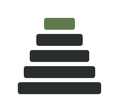

# Varða logo: final concept

Open [`index.html`](index.html) to see every file on one page.

## The idea in one line

A cairn that is also a run: five stones, five kilometers, each one faster than the last.

## The mark: the split cairn



- A **varða** is a stone cairn that marks the way across Iceland's highlands. The mark is five stacked stones.
- Read it as a chart and **each stone is one kilometer**. A shorter stone means a faster km. Every stone is shorter than the one below it, so the cairn is a **negative-split run**: one where you finish faster than you start.
- The **top stone**, the fastest and final kilometer, is the accent color. It's the stone you just placed.
- The geometry is deliberately plain. The personality comes from the wordmark.

Stone widths (bottom to top): 140, 120, 100, 78, 52. Every stone is 20 tall with a corner radius of 4, and the gap between stones is 7.

## The wordmark: VARÐA


- Custom geometric capitals drawn as vector shapes, not set in a font. The stroke is 11 units on a cap height of 60.
- **The Ð carries the brand.** Its crossbar is a small stone in the accent color, the same shape as the cairn's capstone. It's the letter that makes the name Icelandic, and the only accent in the word.
- The **R** leg grows out of the bottom of the bowl and lands flat on the baseline.
- Letters are **spaced by eye**, not by bounding box. The V and A diagonals nest into each other. R–Ð is set tight: the R's open right side already leaves plenty of space, and the Ð stone overhangs into it.
- In code and URLs the name is written `varda`. The Ð appears only in the logo and in running text.

## Tagline

**ONE STONE AT A TIME**, in Avenir Next Demi Bold, converted to outlines. It's **centered under VARÐA** and tracked out to the full width of the word, so both edges line up.

## Colors

| Role | Name | Hex | Used for |
|---|---|---|---|
| Ink (light) | Basalt | `#2B2E2F` | Stones and letters on light backgrounds; app icon background |
| Accent (light) | Moss | `#5E7A4E` | Capstone, Ð stone and tagline on light backgrounds |
| Accent (dark) | Lichen | `#B5C26A` | Capstone, Ð stone and tagline on dark backgrounds |
| Ink (dark) | Snow | `#F3F1EC` | Stones and letters on dark backgrounds; light background |

On light backgrounds, use basalt with moss. On dark backgrounds, use snow with lichen. Never mix them, for example lichen on snow.

## Files

Every logo comes in a light version (for light backgrounds) and a `-dark` version (for basalt). All files are transparent except the app icon.

| File | Use |
|---|---|
| `varda-logo.svg` | **Primary.** Cairn + VARÐA + tagline, side by side |
| `varda-logo-stacked.svg` | Square spaces: splash screen, about page, social avatar |
| `varda-wordmark.svg` | The word alone: nav bars, headers |
| `varda-wordmark-tagline.svg` | Word + tagline, where the cairn appears elsewhere on the page |
| `varda-mark.svg` | The cairn alone: favicon, watch face, small spaces |
| `varda-app-icon.svg` | 512 × 512 app icon, snow cairn on basalt |

## Usage

- **Clear space:** keep at least the height of one stone (or the Ð's stone) clear on every side.
- **Small sizes:** below about 24 px tall, use the mark (`varda-mark`) rather than the full logo. The tagline stops being readable before the word does.
- **Don't:**
  - recolor the capstone or the Ð stone in any color other than the accent;
  - add more accent colors to the word;
  - stretch the logo, or tilt or re-space the stones (the widths *are* the split);
  - retype VARÐA in a font.

## Rebuilding

All files are generated from one script:

```sh
.venv/bin/python logo/build/build_logo.py
```

It needs `fonttools` in `.venv/` (`python3 -m venv .venv && .venv/bin/pip install fonttools`) and reads Avenir Next from macOS (`/System/Library/Fonts/Avenir Next.ttc`), which it uses only for the tagline. Edit the letter positions in `POSITIONS`, the glyph shapes in the `glyph_*` functions, and the colors in `THEMES`.

## Open issues

- **Font license:** the tagline outlines come from Avenir Next, which ships with macOS. That's fine for a personal project. If Varða ever goes public, check the license or switch the tagline to an open font (for example Outfit or Jost) and rebuild.
- **PNG exports** for app stores and favicons haven't been made yet.
- **Splitsmith** hasn't been updated to match yet. It's next: try a hammer, and consider the same custom-caps treatment for its wordmark.

## How we got here

1. Round 1 (`../preview.html`, still in the repo): concepts A (hand-stacked), B (split cairn) and C (vörður). **B chosen**, but felt too generic.
2. Round 2: B with more stone character (chiseled, offset, slabs, faceted). None felt right.
3. Round 3: cairns built from many small rocks. Again, none felt right; **plain B kept**.
4. Personality moved to the wordmark: **custom caps** chosen over the ð in color, a serif, and others.
5. Stones in the A crossbars (loose stones, wedged, route, tiny cairns): too much going on. **Only the Ð stone** kept.
6. R–Ð spacing tightened, keeping the Ð's full overhang.

Rounds 2–5 were throwaway mockups and are not kept in the repo.
